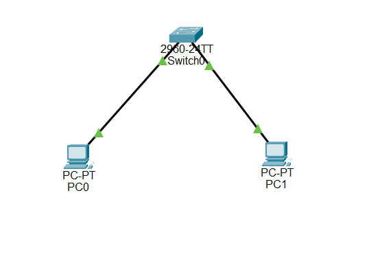

# 🌐 Lab 1 — Building My First LAN

> **My Network Engineering Journey | Beginner Lab**

---

## 📌 Overview

In this lab, I built my first Local Area Network (LAN) using Cisco Packet Tracer. The goal was to connect two computers through a Cisco switch and verify that they could communicate with each other.

## 🎯 Objective

- Understand how a basic LAN operates.
- Connect PCs to a network switch.
- Configure static IP addresses.
- Test network connectivity using the `ping` command.

## 🖥️ Devices & Equipment

| Device | Quantity |
|:---|:---:|
| Cisco 2960 Switch | 1 |
| PCs | 2 |
| Copper Straight-Through Cables | 2 |

## 🗺️ Network Topology



**Network Design:** PC0 and PC1 are connected to Switch0 using Ethernet cables.

## 🔢 IP Addressing Table

| Device | IP Address | Subnet Mask |
|:---|:---|:---|
| PC0 | 192.168.1.10 | 255.255.255.0 |
| PC1 | 192.168.1.20 | 255.255.255.0 |

Both devices belong to the `192.168.1.0/24` network.

## ⚙️ Configuration & Testing

- Connected both PCs to the Cisco 2960 switch.
- Assigned static IPv4 addresses to both PCs.
- Used the `ping` command to test connectivity between PC0 and PC1.

**Test Command:**

```bash
ping 192.168.1.20
```

**Result:** Successful communication between both PCs.

## 📚 Key Concepts Learned

- Local Area Networks (LANs)
- Ethernet connections
- Cisco switches
- IPv4 addressing
- Subnet masks
- Static IP configuration
- ICMP and the `ping` command

## 💡 Reflection

This was my first hands-on networking lab. I learned how to connect devices through a switch, assign IP addresses, and verify connectivity. This lab helped me understand the fundamentals of how devices communicate within a local network.

## 📁 Project Files

| File | Description |
|:---|:---|
| `Lab-01-First-LAN.pkt` | Packet Tracer network simulation |
| `topology.png` | Screenshot of the network topology |
| `README.md` | Lab documentation |

---

**Progress:** Lab 1 Completed ✅

*Continuing my journey into Network Engineering through hands-on labs and practical learning.*
