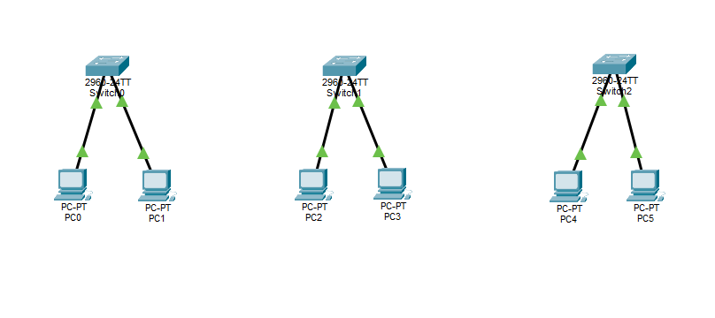

# 🌐 Lab 2 — IP Addressing and Subnetting

> **My Network Engineering Journey | Beginner Lab**

---

## 📌 Overview

In this lab, I divided the `192.168.10.0/24` network into smaller `/26` subnetworks using Cisco Packet Tracer.

The network was designed for three departments: IT, Sales, and Human Resources. Each department was assigned its own subnet with two PCs connected through a Cisco 2960 switch.

## 🎯 Objective

- Understand IPv4 subnetting.
- Learn how CIDR notation works.
- Identify network and broadcast addresses.
- Calculate usable host ranges.
- Assign static IP addresses.
- Test connectivity within separate subnets.

## 🖥️ Devices Used

| Device | Quantity |
|:---|:---:|
| Cisco 2960 Switch | 3 |
| PCs | 6 |
| Copper Straight-Through Cables | 6 |

## 🗺️ Network Topology



## 🔢 Subnetting Information

| Department | Network Address | Subnet Mask | Broadcast Address |
|:---|:---|:---|:---|
| IT | 192.168.10.0/26 | 255.255.255.192 | 192.168.10.63 |
| Sales | 192.168.10.64/26 | 255.255.255.192 | 192.168.10.127 |
| HR | 192.168.10.128/26 | 255.255.255.192 | 192.168.10.191 |

Each subnet provides 62 usable host addresses.

## 💻 IP Addressing Table

| Device | IP Address | Subnet Mask |
|:---|:---|:---|
| PC0 | 192.168.10.10 | 255.255.255.192 |
| PC1 | 192.168.10.11 | 255.255.255.192 |
| PC2 | 192.168.10.70 | 255.255.255.192 |
| PC3 | 192.168.10.71 | 255.255.255.192 |
| PC4 | 192.168.10.130 | 255.255.255.192 |
| PC5 | 192.168.10.131 | 255.255.255.192 |

## ⚙️ Configuration & Testing

Connectivity was tested using the `ping` command.

Example:

```bash
ping 192.168.10.11
```

PCs within the same subnet were able to communicate successfully.

Communication between different subnets failed as expected because no router was configured.

## 📚 Key Concepts Learned

- IPv4 addressing
- CIDR notation
- `/26` subnet masks
- Network addresses
- Broadcast addresses
- Usable host ranges
- Subnet separation
- Basic network troubleshooting

## 💡 Reflection

This lab helped me understand how a larger network can be divided into smaller subnetworks. I learned how to calculate network ranges and assign IP addresses based on subnet boundaries.

I also learned that devices in separate IP networks require routing in order to communicate.

## 📁 Project Files

| File | Description |
|:---|:---|
| `Lab-02-IP-Addressing-and-Subnetting.pkt` | Packet Tracer network simulation |
| `topology.png` | Screenshot of the network topology |
| `README.md` | Lab documentation |

---

**Progress:** Lab 2 Completed ✅
